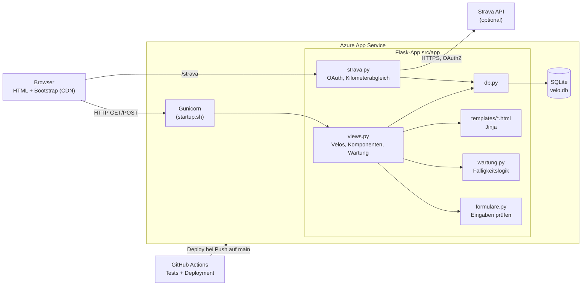
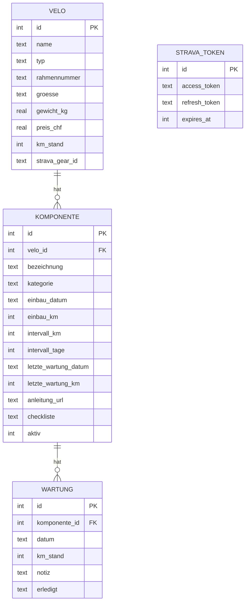
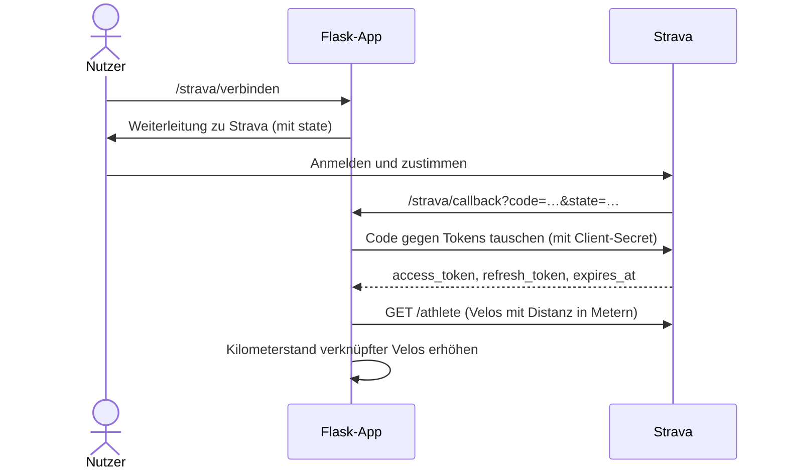

# Architektur

## Komponenten

Die Seiten werden vollständig auf dem Server erzeugt (Jinja-Templates).
Es gibt kein separates JavaScript-Frontend und keinen Build-Schritt.

## Verantwortlichkeiten

| Ort | Was dort passiert |
| --- | --- |
| Browser | Formulare anzeigen, einfache Komfortprüfungen (`required`, `min`) |
| `views.py`, `strava.py` | Anfragen entgegennehmen, Daten lesen und schreiben, Seiten rendern |
| `formulare.py` | Jede Eingabe im Backend prüfen (der Browser lässt sich umgehen) |
| `wartung.py` | Fälligkeit berechnen; kennt weder Flask noch Datenbank, darum gut testbar |
| Datenbank | Daten speichern, Grundregeln absichern (`NOT NULL`, `CHECK`, Fremdschlüssel) |

## Datenmodell

Eine getauschte Komponente wird nicht gelöscht, sondern auf `aktiv = 0`
gesetzt. So bleibt sichtbar, wie viele Kilometer sie gehalten hat.

## Fälligkeitsregel

Gezählt wird ab der letzten Wartung (beim Einbau ist das der Einbau):

* **fällig**: Intervall erreicht oder überschritten
* **bald fällig**: weniger als 10 % der Kilometer oder höchstens 14 Tage übrig
* Hat eine Komponente beide Intervalle, gilt das, was zuerst eintritt.
* Der Status eines Velos ist der dringendste Status seiner Komponenten.

## Ablauf Strava-Anmeldung (OAuth2)

