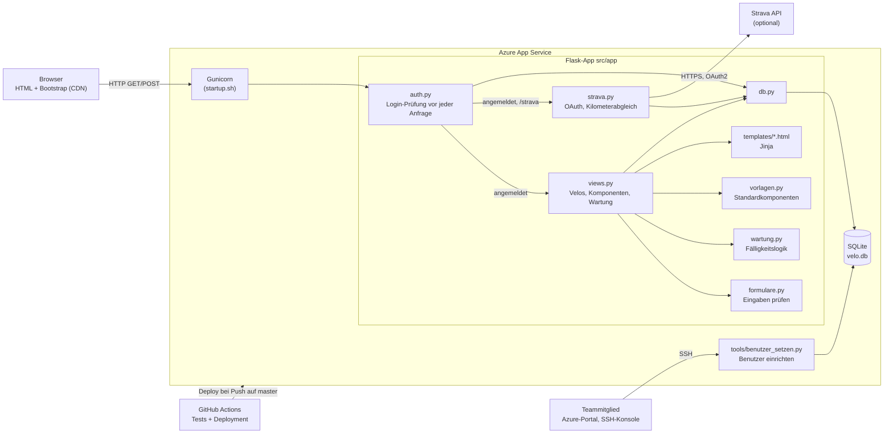
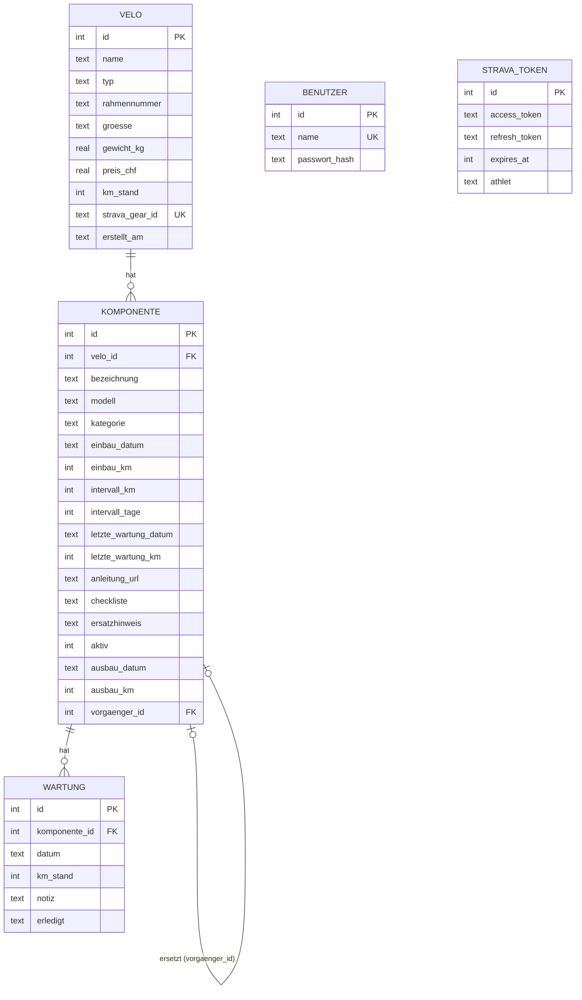
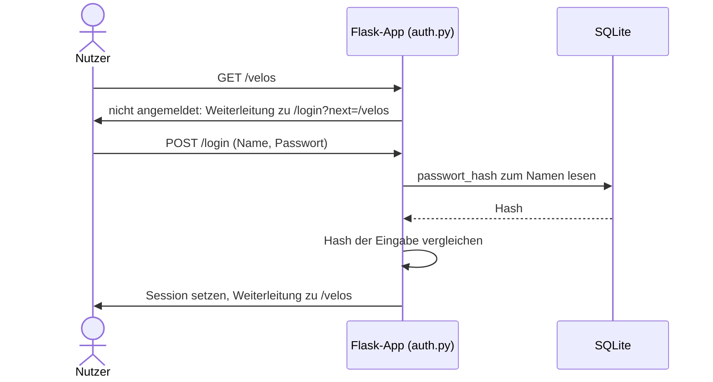
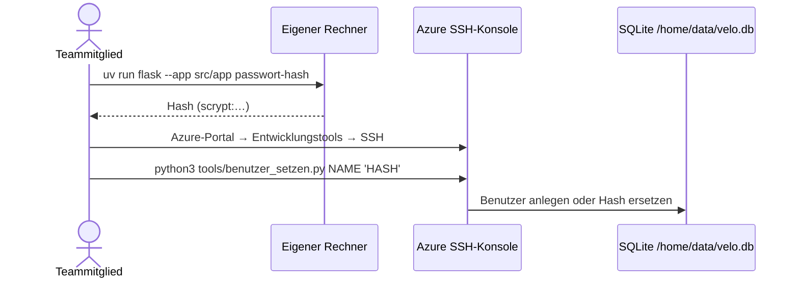
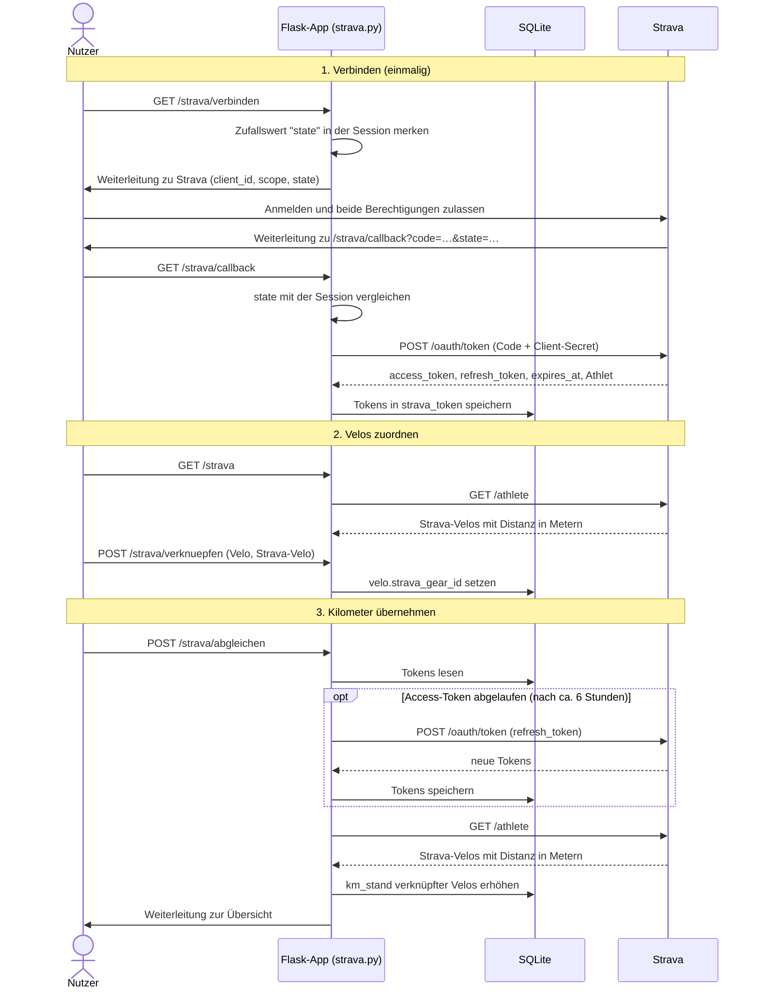

# Architektur

## Komponenten

Die Seiten werden vollständig auf dem Server erzeugt (Jinja-Templates).
Es gibt kein separates JavaScript-Frontend und keinen Build-Schritt.

## Verantwortlichkeiten

| Ort | Was dort passiert |
| --- | --- |
| Browser | Formulare anzeigen, einfache Komfortprüfungen (`required`, `min`) |
| `auth.py` | Vor jeder Anfrage prüfen, ob jemand angemeldet ist; Login und Logout |
| `views.py`, `strava.py` | Anfragen entgegennehmen, Daten lesen und schreiben, Seiten rendern |
| `formulare.py` | Jede Eingabe im Backend prüfen (der Browser lässt sich umgehen) |
| `wartung.py` | Fälligkeit berechnen; kennt weder Flask noch Datenbank, darum gut testbar |
| `vorlagen.py` | Standardkomponenten mit Richtwerten für neue Velos; reine Daten, kein Flask |
| Datenbank | Daten speichern, Grundregeln absichern (`NOT NULL`, `CHECK`, Fremdschlüssel) |

## Datenmodell

Eine ausgebaute Komponente wird nicht gelöscht, sondern auf `aktiv = 0`
gesetzt, mit `ausbau_datum` und `ausbau_km`. So bleibt sichtbar, wie viele
Kilometer sie gehalten hat. Bei einem Tausch zeigt die neue Komponente mit
`vorgaenger_id` auf die alte. Darüber lässt sich der Tausch rückgängig
machen ([Entscheid 0007](decisions/0007-nur-letzten-schritt-rueckgaengig.md)).

`BENUTZER` und `STRAVA_TOKEN` stehen für sich allein: Alle angemeldeten
Benutzer sehen dieselben Velos, und es gibt nur eine Strava-Verbindung
([Entscheide 0009](decisions/0009-benutzer-in-der-datenbank.md) und
[0010](decisions/0010-strava-app-und-verbindung.md)).

## Login und Benutzer einrichten

`auth.login_erzwingen` läuft vor jeder Anfrage. Ohne Anmeldung leitet es auf
`/login` weiter; nur `/login` und die statischen Dateien sind frei. In der
Datenbank steht nur der Hash des Passworts.

Eine Registrierung in der App gibt es nicht. Benutzer richtet ein
Teammitglied direkt auf dem Server ein:

Der Hash wird nur von Hand in die SSH-Konsole kopiert. Er gehört weder ins
Repository noch in Issues, weil beide öffentlich sind.

## Fälligkeitsregel

Gezählt wird ab der letzten Wartung (beim Einbau ist das der Einbau):

* **fällig**: Intervall erreicht oder überschritten
* **bald fällig**: höchstens 10 % der Kilometer oder höchstens 14 Tage übrig
* Hat eine Komponente beide Intervalle, gilt das, was zuerst eintritt.
* Der Status eines Velos ist der dringendste Status seiner Komponenten.

## Ablauf Strava (OAuth2 und Kilometerabgleich)

Die Strava-Anbindung läuft in drei getrennten Schritten. Der Callback
speichert nur die Tokens, Kilometer ändern sich erst beim Abgleich.

Der Kilometerstand wird nur erhöht, nie verkleinert. Von Hand eingetragene
Kilometer gehen so nicht verloren. Client-ID und Client-Secret stehen nur in
Umgebungsvariablen, die Tokens in der Datenbank.
